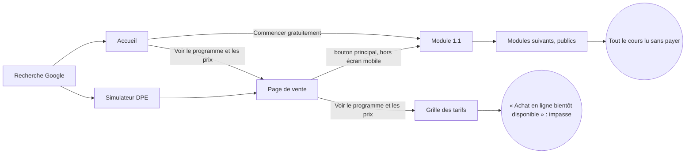
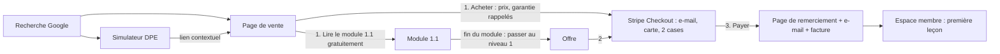

# Audit de vente : formation-locatif.com

Audit du 28 septembre 2026, sur la version 020 du site (commit `cf85e2f`), branche `optim/vente`.
Méthode : build local, captures Playwright en 375 × 667 et 1440 × 900 (`audit/avant/`), Lighthouse 13 en
profil mobile, lecture du code source. Chaque constat donne sa preuve : fichier et ligne, capture ou mesure.
Trois étiquettes distinguent ce qui est établi de ce qui ne l'est pas :

- **Constat** : ce qui est mesuré ou lu dans le code ;
- **Hypothèse** : ce que l'on suppose de l'effet sur les acheteurs, à vérifier par le test humain ;
- **Reco** : ce qu'il faut changer.

Chiffres de référence retenus (décision du propriétaire du 28 septembre 2026 : « on prend les dernières
références ») : 3 niveaux, 38 modules, 122 questions de quiz, 380 exercices corrigés, 24 simulateurs,
10 modèles de lettres, 7 checklists, 180 termes de glossaire, 9 annexes, 3 examens de niveau, un examen
final et un test final de 50 questions, plus de 1 200 réponses dans l'outil « Poser une question ». Contenu
à jour au 24 septembre 2026. Prix : 97 €, 197 € et 297 € le niveau, 447 € les trois niveaux (au lieu de
591 € achetés séparément). Le paiement en ligne (Stripe) sera mis en place quand le propriétaire aura son
compte.

---

## 1. Verdict

**NO-GO : ne pas envoyer de trafic, surtout payant, tant que le paiement n'est pas en place.**

| | Avant | **Après le plan (mesuré, § 15)** | Projection après Stripe et les [À FOURNIR] |
|---|---|---|---|
| Note sur 100 | **52** | **69** | 90 à 93 |
| Portes bloquantes en échec | G1, G2, G4, G7 (+ G3 et G8 partielles) | **G1, G2, G4** (+ G3 et G8 partielles) | aucune, si le parcours d'achat est testé |
| Test des 5 secondes, page de vente mobile | **8 / 12** | **11 / 12** | 12 / 12 (auteur nommé) |
| Test des 5 secondes, accueil mobile | **10 / 12** | **11 / 12** | 12 / 12 |

**Les trois blocages principaux :**

1. **On ne peut pas acheter.** Aucune offre n'a de lien d'achat. La grille affiche « Achat en ligne bientôt
   disponible » (`site/src/components/Tarifs.astro:48`). Portes G2, G4 et G8 (récapitulatif).
2. **Le contenu payant est public.** Toute la formation est en ligne dans l'édition complète. Porte G1. La
   solution est prévue : l'édition « outils » (`EDITION=outils`) plus un espace membre, au lancement de Stripe.
3. **Les mentions obligatoires sont vides.** Treize champs sont vides dans `site/src/lib/entreprise.ts` :
   éditeur, e-mail, médiateur, mention de TVA, garantie, accès, auteur… Porte G3. Conséquence directe : le
   bonus « Vos questions par e-mail » (`formation-investissement-locatif.astro:101`) promet une réponse sous
   72 heures alors qu'aucune adresse n'est affichée.

**Les trois gains rapides :**

1. **Faire entrer le bouton principal dans le premier écran mobile de la page de vente.** Il commence
   aujourd'hui à 696 px, sous l'écran de 667 px (porte G7). Il suffit de raccourcir le chapeau.
2. **Rendre le bouton honnête.** « Commencer gratuitement le niveau 1 » renvoie au seul module 1.1, qui est
   aussi le seul marqué « (gratuit) » dans le programme et sur la page Tarifs. Nouveau libellé : « Lire le
   module 1.1 gratuitement ».
3. **Afficher le prix et le gratuit dès le premier écran mobile**, en une ligne sous le bouton :
   « Module 1.1 gratuit · puis dès 97 € le niveau ».

---

## 2. Les huit portes bloquantes

| # | Porte | État | Preuve | Ce qui la fait passer |
|---|---|---|---|---|
| G1 | Contenu payant protégé | **Échec** | `COURS_PUBLIC` vrai dans l'édition publiée : `/module/2-1/`, `/examen/final/` et `/annexe/…` répondent en 200 sans compte (108 routes, toutes publiques). | Au lancement de Stripe : publier l'édition « outils » (déjà construite par `EDITION=outils`) et servir le cours payant derrière un espace membre. **Prévu, dépend du compte Stripe.** |
| G2 | Paiement de bout en bout | **Échec** | `OFFRES[*].lienAchat` absent (`site/src/lib/seo.ts`) ; « Achat en ligne bientôt disponible ». | Liens Stripe Checkout, puis un achat test (mode test) jusqu'à l'accès, la facture et l'e-mail. **Prévu.** |
| G3 | Documents légaux | **Partiel** | Les pages mentions légales, CGV et confidentialité existent (`/mentions-legales/`, `/cgv/`, `/confidentialite/`). Treize champs sont vides, dont le médiateur (`entreprise.ts:44`) et la mention de TVA (`entreprise.ts:30`). Pas de cookies, donc pas de bandeau nécessaire aujourd'hui. | Remplir `EDITEUR` et `CONDITIONS` ([À FOURNIR] n° 3, 4, 6, 7). |
| G4 | Rétractation numérique | **Échec** | Le texte des CGV est juste (L. 221-28 13°), mais il n'existe pas de page de paiement, donc pas les deux cases. | Stripe Checkout : case « accès immédiat » et case « renonciation au droit de rétractation », non pré-cochées, via les champs personnalisés ou `consent_collection`. Confirmation écrite dans l'e-mail de reçu. **Prévu.** |
| G5 | Aucune affirmation trompeuse | **Presque** | Passe complète faite (§ 4). Deux points : le libellé « Commencer gratuitement le niveau 1 » (seul le module 1.1 est gratuit dans l'offre payante) et le bonus « Vos questions par e-mail » sans adresse affichée. | Actions A2 et A6. |
| G6 | Aucune erreur sur les pages publiques | **Réussite** | `npm run test:site` : 4 554 contrôles, zéro lien ni ressource cassé. Zéro erreur de console sur les 8 pages capturées (16 affichages). `sitemap.xml` et `robots.txt` servis. Aucun `_vercel` dans `dist/`. | – |
| G7 | Bouton principal visible sans défiler, 375 × 667 | **Échec** (page de vente) | Page de vente : bouton à y = 696 px, hauteur 64 px (`audit/avant/vente-375-haut.png`). Accueil : y = 537 px, réussite. Tarifs : y = 337 px, réussite. | Action A1. |
| G8 | Prix TTC visible avant paiement | **Partiel** | Page de vente : le prix est dans le bandeau en 1440 px, mais pas dans le premier écran mobile. Pas de mention TTC ni de TVA (`CONDITIONS.mentionPrix` vide). Pas de récapitulatif, faute de paiement. | Action A1, mention de TVA ([À FOURNIR] n° 6), récapitulatif Stripe. |

---

## 3. Test des 5 secondes

Notes données **uniquement** à partir des captures du premier écran (0 = absent, 1 = flou, 2 = clair).

### Page de vente

| Question | Mobile 375 (`vente-375-haut.png`) | Ordinateur 1440 (`vente-1440-haut.png`) |
|---|---|---|
| 1. Qu'est-ce que c'est ? | 2. « Formation en ligne », titre explicite. | 2 |
| 2. Pour qui ? | 2. « Formation pour bailleurs », ligne « Pour les bailleurs en place… ». | 2 |
| 3. Quel résultat concret ? | 2. « gardez votre logement louable et votre location en règle ». | 2 |
| 4. Pourquoi y croire ? | 1. Seulement la date de mise à jour et les chiffres du chapeau ; pas d'auteur, pas de source visible. | 1 |
| 5. Combien, et qu'est-ce que j'obtiens ? | 1. Le contenu est donné (38 modules, 24 simulateurs…), mais le prix n'est pas dans l'écran. | 2. « Dès 97 € le niveau · 447 € les trois niveaux ». |
| 6. Que faire maintenant ? | **0**. Aucun bouton dans l'écran. | 2 |
| **Total** | **8 / 12** | **11 / 12** |

**Corrections exactes (mobile) :**

- **Question 6.** Ramener le chapeau (`formation-investissement-locatif.astro:182`) à une phrase de 25 mots
  environ :
  > « DPE, loyer, bail, charges, impayés, impôts : les règles de la location, dans l'ordre où vous en avez
  > besoin. À jour au 24 septembre 2026. »

  Déplacer les chiffres (38 modules, 24 simulateurs, 10 lettres) dans une ligne courte sous le bouton.
  Supprimer la ligne « pour qui » du premier écran : le titre dit déjà « pour bailleurs », et la ligne
  reste dans la section « Pour qui ? ».
- **Question 5.** Sous le bouton, une ligne : « Module 1.1 gratuit, sans inscription · puis dès 97 € le
  niveau ».
- **Question 4.** Sans auteur nommé, la meilleure preuve disponible est le sourçage. Ajouter dans le
  bandeau : « Textes officiels cités dans chaque module (Légifrance, service-public, BOFiP) ». La note
  passe à 2 quand l'auteur est nommé ([À FOURNIR] n° 5).

### Accueil

| Question | Mobile 375 (`accueil-375-haut.png`) | Ordinateur 1440 (`accueil-1440-haut.png`) |
|---|---|---|
| 1. Qu'est-ce que c'est ? | 2. « Formation en ligne · à jour au 24 septembre 2026 ». | 2 |
| 2. Pour qui ? | 2. « Tout ce qu'un bailleur doit savoir ». | 2 |
| 3. Quel résultat concret ? | 2 | 2 |
| 4. Pourquoi y croire ? | 1. Date seule. | 1. Date et compteurs (38 modules, 380 exercices). |
| 5. Combien, et qu'est-ce que j'obtiens ? | 1. « Voir le programme et les prix », mais aucun montant. | 1 |
| 6. Que faire maintenant ? | 2. « Commencer gratuitement → ». | 2 |
| **Total** | **10 / 12** | **10 / 12** |

**Corrections exactes (accueil) :**

- **Question 5.** Sous les boutons du hero (`site/src/cours/formation.astro`, vers la ligne 49), ajouter la
  ligne « Module 1.1 gratuit · niveaux dès 97 € · 447 € les trois ».
- **Question 4.** Même ligne de sourçage que sur la page de vente.
- Le lien « Voir le programme et les prix » ne mesure que **28 px de haut**, sous la cible tactile de 44 px.
  Lui donner un `padding-block` qui le porte à 44 px.

---

## 4. Analyse phrase par phrase (page de vente)

Mesures sur le texte visible extrait par Playwright : 175 blocs, 180 phrases.

| Mesure | Résultat | Cible |
|---|---|---|
| Longueur moyenne des phrases | **12,2 mots** | < 20 : atteinte |
| Phrases de plus de 25 mots | **15** | à réduire |
| Jargon au-dessus de la ligne de flottaison | « DPE » (deux fois), sans explication | aucun jargon non expliqué |
| Adresses au lecteur (« vous », « votre », « vos ») | 31, contre 22 « nous » ou « la formation » | bénéfice d'abord |
| Rapport bénéfices sur caractéristiques (estimation manuelle par bloc) | environ **45 %** | ≥ 60 % |
| Liste noire | 1 vraie occurrence : « Vous gagnez du temps » (ligne 107, « gagnez ») | 0 |

Les autres correspondances de la liste noire ne sont pas des fautes, car ce sont des négations honnêtes :

- « pas des gains garantis » ;
- « une méthode pour vous enrichir rapidement » dans « Ce n'est pas pour vous si… » ;
- « certifiante ou éligible au CPF ? Non. ».

### Phrases à supprimer

| Phrase | Test échoué | Raison |
|---|---|---|
| « Vous gagnez du temps et vous évitez les oublis. » (FAQ 1) | Liste noire, concret | Remplacer par un fait : « Vous n'avez plus à rapprocher les textes vous-même. » |
| La ligne « Pour les bailleurs en place (DPE, loyer, bail, impôts), ceux qui gèrent seuls, et les futurs investisseurs : le niveau 1 part de zéro. » dans le bandeau | Suppression | Elle fait doublon avec le titre et la section « Pour qui ? », et repousse le bouton sous la ligne de flottaison. |

### Phrases à réécrire

| Phrase actuelle | Test | Réécriture |
|---|---|---|
| Chapeau (58 mots) | Et alors ?, longueur | « DPE, loyer, bail, charges, impayés, impôts : les règles de la location, dans l'ordre où vous en avez besoin. À jour au 24 septembre 2026. » |
| Puce « Un outil "Poser une question"… » (57 et 41 mots) | Longueur | « Posez votre question avec vos mots : l'outil affiche le passage de la formation qui y répond, avec sa source. Plus de 1 200 réponses. » |
| « S'y ajoutent les autres erreurs de bailleur qui se paient… » (39 mots) | Longueur | Garder la liste, en deux phrases : « D'autres erreurs coûtent aussi : un dépôt de garantie rendu en retard, un congé mal délivré, un impayé mal géré, un régime fiscal mal choisi. » |
| FAQ « Mon logement est classé F ou G » (36 mots) | Longueur | Couper après « les aides. » |
| « Comment fonctionne la formation » (titre) | Et alors ? | « Ce que vous faites, module après module » |
| Bouton « Commencer gratuitement le niveau 1 » (× 2) | Preuve (G5) | « Lire le module 1.1 gratuitement » |

### Phrases à conserver telles quelles

- Le titre h1 : spécifique, 12 mots, sans promesse de gain.
- Le bloc « Votre logement sera-t-il encore louable en 2028 ? », avec ses dates exactes.
- Les deux exemples chiffrés, avec la mention « Exemples pédagogiques… pas des gains garantis ».
- « Ce n'est pas pour vous si… ».
- Le comparatif « Chercher seul / Suivre la formation » : il est concret et sourcé.
- La réponse « Non. » à la question du CPF : honnête et courte.

---

## 5. Architecture de la page de vente : les 14 blocs

| # | Bloc | État | Constat | Reco |
|---|---|---|---|---|
| 1 | Titre, sous-titre, bouton, preuve, visuel | **Faible** | Bouton hors écran sur mobile ; pas de preuve courte ; pas de visuel réel du produit. | A1, plus une capture réelle d'une leçon ou d'un simulateur (`audit/avant/module-gratuit-1-1-1440-haut.png` peut servir de base). |
| 2 | Problème et coût | Présent | Calendrier DPE, deux exemples chiffrés sourcés (module 2.6, examen final). | – |
| 3 | Solution et mécanisme | Présent | « Comment fonctionne la formation » : 5 puces. Titre en caractéristiques. | Retitrer en bénéfice (§ 4). |
| 4 | Programme repliable | Présent | 3 `
` avec modules, durée et prix. | – |
| 5 | Démonstration | Présent | « Essayez avant d'acheter » : module 1.1, parcours « Commencer ici », checklist, outil de questions, simulateurs, lettres. | Ajouter un bouton principal après ce bloc (A4). |
| 6 | Pour qui / pas pour qui | Présent | 3 profils plus « Ce n'est pas pour vous si… ». | – |
| 7 | Chercher seul vs formation | Présent | Tableau de 8 lignes. | – |
| 8 | Auteur et méthode | **Faible** | Le titre devient « La méthode » faute d'auteur ; pas de nom ni de photo. | [À FOURNIR] n° 5. |
| 9 | Preuves (avis, relecture) | **Absent** | `AVIS` vide, section masquée ; aucune relecture professionnelle déclarée. | Ne rien inventer : laisser masqué. Recueillir les avis des premiers acheteurs ([À FOURNIR] n° 12). |
| 10 | L'offre | Présent mais incomplet | Prix, contenu par niveau, pack, bonus. Accès, mises à jour, facture et TVA non précisés ; pas d'achat possible. | [À FOURNIR] n° 1, 6, 8, 9, 10 ; A6. |
| 11 | Garantie | **Absent** | `CONDITIONS.garantie` vide ; la FAQ ne cite que le droit de rétractation. | Décision du propriétaire n° 1. |
| 12 | FAQ ≥ 15 | Présent | 18 questions visibles, mais 3 objections sans réponse (paiement fractionné, durée d'accès, compréhension d'un module) et 1 réponse conditionnelle (facture). | A5. |
| 13 | Bouton final + garantie | **Faible** | Bouton final présent (y = 9 680 px sur mobile), sans rappel de garantie ni de prix. Aucun bouton principal entre le haut et la fin de la page (9 000 px). | A4, puis rappel de la garantie quand elle existe. |
| 14 | Avertissement | Présent | Composant `Avertissement` en fin de page, texte de la section 0.4. | – |

**Bilan** : 8 blocs présents, 4 faibles ou incomplets, 2 absents (preuves, garantie). Ces deux derniers
dépendent du propriétaire.

---

## 6. Carte des 20 objections

| # | Objection | Où la page répond | Comment | Convaincant ? |
|---|---|---|---|---|
| 1 | « Tout est gratuit sur service-public et l'ANIL » | Section « Tout est sur service-public.fr ? Presque. » ; FAQ 1 | Comparatif en 8 lignes, sources citées | **Oui** |
| 2 | « Je n'ai pas encore de bien » | FAQ 2 ; « Pour qui ? » (futur investisseur) | Niveau 1 pour débutant complet | **Oui** |
| 3 | « La loi change, ce sera périmé » | FAQ 3 et 9 ; « À surveiller » | Date affichée, journal des mises à jour | Partiel : inclusion des mises à jour après achat [À FOURNIR] |
| 4 | « Trop technique » | FAQ 4 | Glossaire de 180 termes, quiz, exercices | **Oui** |
| 5 | « Qui êtes-vous ? » | FAQ « Qui êtes-vous ? » ; bloc « La méthode » | Renvoi vers « Méthode et sources » | **Non** : aucun nom [À FOURNIR] |
| 6 | « Combien de temps ça prend ? » | FAQ 5 ; programme | Durée par niveau | **Oui** |
| 7 | « Est-ce vraiment à jour ? » | Bandeau ; FAQ 3 | « Contenu à jour au 24 septembre 2026 » | **Oui** |
| 8 | « Puis-je être remboursé ? » | FAQ 7 | Droit de rétractation et exception L. 221-28 | Partiel : juste mais dissuasif sans garantie |
| 9 | « Aurai-je une facture ? » | Nulle part (question masquée si `CONDITIONS.facture` est vide) | – | **Non** [À FOURNIR] |
| 10 | « Est-ce un conseil personnalisé ? » | FAQ ; avertissement | Non, professionnels cités | **Oui** |
| 11 | « Puis-je payer en plusieurs fois ? » | Nulle part (question masquée) | – | **Non** [À FOURNIR] |
| 12 | « Lisible sur mobile ? » | FAQ 6 | Oui, testé | **Oui** (confirmé par les mesures) |
| 13 | « Combien de temps ai-je accès ? » | Nulle part | – | **Non** [À FOURNIR] |
| 14 | « Mises à jour incluses ? » | FAQ 9 | Rythme des mises à jour ; inclusion conditionnelle | Partiel [À FOURNIR] |
| 15 | « Y a-t-il un accompagnement ? » | FAQ 8 ; bonus | Outil de questions et e-mail sous 72 h | Partiel : aucune adresse e-mail affichée |
| 16 | « Je gère déjà un bien, est-ce pour moi ? » | « Pour qui ? » ; FAQ « Par quel niveau commencer ? » | Profil « bailleur en place » | **Oui**, mais pas en FAQ |
| 17 | « Est-ce fiable, y a-t-il des avis ? » | « La méthode » | Sources officielles, pas d'avis | Partiel : pas d'avis ni de relecture |
| 18 | « Mes données sont-elles protégées ? » | FAQ dernière | Aucun cookie ni traceur | **Oui** |
| 19 | « Pourquoi ce prix ? » | FAQ 1, comparatif, pack au lieu de 591 € | Implicite | Partiel : pas de réponse directe |
| 20 | « Et si je ne comprends pas un module ? » | Nulle part directement | – | **Non** : la réponse existe (glossaire, outil de questions, e-mail) mais n'est pas écrite |

**Bilan** : 9 objections levées, 6 partiellement, 5 non. Les réponses aux objections 16, 19 et 20 peuvent
être écrites dès maintenant (A5). Les objections 5, 9, 11 et 13 attendent le propriétaire ; en attendant,
une réponse provisoire honnête est proposée dans `audit/reecritures.md`.

---

## 7. Preuves et confiance

| Source de confiance | État | Preuve | Texte provisoire honnête, en attendant |
|---|---|---|---|
| Présentation de l'auteur | **Absente** | `AUTEUR.nom` vide | « La formation est écrite et mise à jour par l'éditeur du site ; la page Méthode et sources explique comment chaque règle est vérifiée. » [À FOURNIR] |
| Page « Méthode et sources » | Présente | `/methode-et-sources/` | – |
| Sources officielles avec liens | Présentes | Textes de référence en fin de chaque module, annexe H | – |
| Date de mise à jour visible | Présente | Bandeau, accueil, pied des modules | – |
| Relecture professionnelle | Absente | Rien de déclaré | Ne rien affirmer. [À FOURNIR] si une relecture a eu lieu (nom, qualité, date). |
| Avis vérifiables | Absents | `AVIS = []` | Section masquée, à laisser masquée. |
| Mentions légales complètes | **Incomplètes** | 13 champs vides | Les pages affichent « à compléter ». |
| Moyen de contact | **Absent** | `EDITEUR.email` vide | Tant qu'il est vide, retirer le bonus « Vos questions par e-mail » (A6). |
| Sécurité du paiement | Sans objet | Pas de paiement | Au lancement : « Paiement sécurisé par Stripe ; nous ne voyons jamais votre numéro de carte. » |

---

## 8. Offre, prix et garantie

### Clarté de l'offre

| Élément | État |
|---|---|
| Contenu acheté | Clair : modules, quiz, examen et checklists du niveau (`formation-investissement-locatif.astro`, section « Choisissez votre niveau »). |
| Ce qui reste gratuit | Clair : module 1.1, simulateurs, lettres. Contredit par le bouton « Commencer gratuitement le niveau 1 » (A2). |
| Durée d'accès | [À FOURNIR] |
| Mises à jour | [À FOURNIR] (inclusion) |
| Formats | Clair : écrit, pas de vidéo (FAQ). |
| Prix | 97 €, 197 €, 297 €, 447 € ; « au lieu de 591 € » est la vraie somme des trois prix, **ce n'est pas un prix barré fictif**. |
| TTC ou TVA | [À FOURNIR] : « TVA non applicable, art. 293 B du CGI » en micro-entreprise, ou « Prix TTC ». |
| Paiement fractionné | [À FOURNIR] |
| Comparaison honnête | Présente sous forme d'exemples (2 000 € d'impôt par an, 11 800 € à la revente), jamais comme gain promis. |

### Trois structures d'offre à tester (aucun prix fixé ici)

1. **Structure actuelle, quatre choix** : niveau 1, niveau 2, niveau 3, formation complète. Elle convient à
   qui ne veut qu'un niveau. Risque : trop de choix sur mobile (4 cartes).
2. **Deux choix, la formation complète mise en avant** : « Niveau 1 seul » et « Formation complète », les
   niveaux 2 et 3 restant accessibles via un lien « Acheter un autre niveau seul ». C'est plus simple à
   décider. Le prix de chaque carte reste celui fixé par le propriétaire.
3. **Commencer petit, compléter ensuite** : acheter le niveau 1, puis passer à la formation complète en ne
   payant que la différence. C'est honnête et rassurant pour un débutant. Techniquement, il faut un code de
   réduction Stripe à usage unique ou un produit « complément ». Montant fixé par le propriétaire.

### Garantie

- **Constat** : aucune garantie (`CONDITIONS.garantie` vide). La FAQ ne parle que du droit de rétractation.
  Avec la renonciation expresse pour un accès immédiat, ce droit disparaît en pratique : c'est juste, mais
  dissuasif.
- **Cohérence juridique** : une garantie commerciale volontaire (« remboursé sous 14 jours sur simple
  demande ») reste possible même après la renonciation au droit légal. Elle doit être écrite dans les CGV,
  en langage simple.
- **Reco** : c'est la décision n° 1 du propriétaire. Si elle est prise, l'afficher sous chaque bouton
  « Acheter » et sous le bouton final.

---

## 9. Boutons, friction et parcours

### Inventaire (mesures 375 × 667, `mesures-avant.json`)

| Page | Libellé | Position y | Taille | Contraste | Destination | Remarque |
|---|---|---|---|---|---|---|
| Vente | **Commencer gratuitement le niveau 1** (principal) | 696 | 343 × 64 | 15,8 | `/module/1-1/` | Hors écran (G7) ; libellé inexact |
| Vente | Voir le programme et les prix | 772 | 281 × 45 | 15,8 | `#offre` | OK |
| Vente | Vérifiez gratuitement s'il reste louable | 829 | 254 × 46 | 14,6 | `/simulateurs/dpe-location/` | OK |
| Vente | Le module 1.1 en entier | 4 832 | 187 × **24** | 7,6 | `/module/1-1/` | Lien dans le texte |
| Vente | module 1.1 | 8 497 | 63 × **17** | 7,6 | `/module/1-1/` | Lien dans le texte |
| Vente | Commencer gratuitement le niveau 1 (principal) | 9 680 | 320 × 44 | 15,8 | `/module/1-1/` | 9 000 px sans bouton principal avant lui |
| Accueil | Commencer gratuitement → (principal) | 537 | 300 × 49 | 15,8 | `/module/1-1/` | OK |
| Accueil | Voir le programme et les prix | 603 | 249 × **28** | 14,6 | page de vente | Cible tactile trop petite |
| Accueil | Faire le test DPE | 919 | 290 × 44 | 15,8 | simulateur | OK |
| Tarifs | Commencer gratuitement le niveau 1 (principal) | 337 | 343 × 64 | 15,8 | `/module/1-1/` | Libellé inexact |
| Tarifs | (aucun bouton d'achat) | – | – | – | – | « Achat en ligne bientôt disponible » |

- **Un objectif par page** : respecté. L'objectif principal est de commencer le module gratuit, et le prix
  vient en second.
- **Clics jusqu'au paiement** : impossible aujourd'hui, le parcours s'arrête sur la grille des tarifs.

### Parcours réel

### Parcours idéal (après Stripe)

### Points de friction et corrections

| # | Friction | Preuve | Correction |
|---|---|---|---|
| F1 | Bouton principal sous la ligne de flottaison (vente mobile) | y = 696 > 667 | A1 |
| F2 | Libellé « le niveau 1 » alors que seul le 1.1 est gratuit | Programme : « Module 1.1 (gratuit) » ; `Tarifs.astro` : « Le module 1.1 est gratuit » | A2 |
| F3 | 9 000 px sans bouton principal | y = 696, puis 9 680 | A4 : bouton après « Le problème », après le comparatif et après « Essayez avant d'acheter » |
| F4 | Impasse « bientôt disponible » | `Tarifs.astro:48` | A6 : dire la vérité et proposer une suite (commencer le gratuit ; plus tard, être prévenu par e-mail quand `FORMULAIRE_EMAIL` sera renseigné) |
| F5 | Lien de 28 px de haut sur l'accueil | mesure | A7 |
| F6 | Fin du module 1.1 : aucune invitation à l'offre | À vérifier dans `/module/1-1/` au lancement du paiement | Au lancement : encart « Continuer le niveau 1 : 97 € » en fin de module gratuit |
| F7 | Bouton flottant « Une question ? » par-dessus le texte en mobile | `vente-375-haut.png` | Faible : acceptable, c'est un argument de vente. À surveiller au test humain. |

---

## 10. Mobile et vitesse

Lighthouse 13, profil mobile (simulation 4G lente, CPU ralenti), sur le build local.

| Page | Perf. | Access. | Bonnes pratiques | SEO | LCP | CLS | TBT | Poids |
|---|---|---|---|---|---|---|---|---|
| Accueil | 97 | 100 | 100 | 100 | 2,0 s | 0 | 0 ms | 143 Kio |
| **Page de vente** | **99** | **100** | 100 | 100 | 1,8 s | 0 | 0 ms | 147 Kio |
| Tarifs | 99 | 100 | 100 | 100 | 1,8 s | 0 | 0 ms | 141 Kio |
| Niveau 1 | 100 | 100 | 100 | 100 | 1,8 s | 0 | 0 ms | 141 Kio |
| Module 1.1 | 99 | 100 | 100 | 100 | 2,0 s | 0 | 0 ms | 154 Kio |
| Simulateur rentabilité | 99 | 100 | 100 | 100 | 2,0 s | 0 | 0 ms | 170 Kio |
| Glossaire | 99 | 100 | 100 | 100 | 2,0 s | 0 | 0 ms | 154 Kio |
| Commencer ici | 100 | 100 | 100 | 100 | 1,8 s | 0 | 0 ms | 141 Kio |

**Autres constats :**

- Aucun script tiers : l'audit « third-party-summary » est vide sur les 8 pages.
- Aucune image lourde ; les polices sont auto-hébergées.
- Aucun défilement horizontal : débordement de 0 px sur les 16 affichages.
- L'INP n'est pas mesurable en laboratoire ; le TBT de 0 ms en est le meilleur indicateur.
- **Textes de moins de 16 px** (blocs de plus de 40 caractères) : page de vente 15, niveau 14, module 28,
  glossaire 87, simulateur 8. Ce sont surtout des métadonnées (`.registre__meta`, 0,8 à 0,92 rem) et les
  cellules de tableau.
  - Reco A8 : 16 px minimum pour les textes de la page de vente.
  - Le contenu pédagogique n'est pas touché. Seul le CSS des métadonnées de la page de vente change.
- Tableau comparatif sur 360 px : il est dans une région défilante étiquetée (`.tableau`,
  `role="region"`, `tabindex="0"`). Il reste lisible.
- **Cibles tactiles** : un lien à 28 px (accueil) ; les liens dans le texte à 17 et 24 px sont acceptés par
  WCAG 2.5.8 (exception « en ligne »).
- Clavier mobile : il n'y a pas de formulaire d'achat. La saisie « Une question ? » utilise un `textarea`
  avec étiquette. Le formulaire e-mail utilise `type="email"` et `autocomplete="email"`.

---

## 11. Référencement et plan de marquage

### Référencement de la page de vente

| Élément | Valeur | Avis |
|---|---|---|
| Titre | « Formation propriétaire bailleur : programme, prix et module gratuit » (67 caractères) | Bon ; vise « formation propriétaire bailleur ». |
| Méta-description | « Formation en ligne pour propriétaires bailleurs : DPE et logement F ou G, loyer, bail, impôts. 38 modules, module 1.1 gratuit, dès 97 €. » | Bonne ; aucun mot de la liste noire. |
| h1 | « Formation pour bailleurs : gardez votre logement louable et votre location en règle » | Bon, sans bourrage. |
| URL | `/formation-investissement-locatif/` | Vise « formation investissement locatif » ; l'accueil vise la même requête (titre « Formation investissement locatif en ligne… »). **Hypothèse** : cannibalisation légère. Reco : garder, la canonique de chaque page est propre. |
| Canonique | Unique, vérifiée par `check-indexation.ts` | OK |
| Données structurées | `Course` + 3 `Course` en parties, 4 `Offer`, `CourseInstance`, `BreadcrumbList` | OK. Pas de `Product` : `Course` avec `offers` est le type attendu par Google pour une formation. Pas de `FAQPage` : depuis 2023, Google n'affiche plus ce résultat enrichi que pour les sites officiels et de santé. Gain faible, action A10 facultative. |
| Plan du site, robots.txt | Servis, 105 pages publiques | OK |

### Plan de marquage

- **Outil recommandé : Plausible.** Il ne pose aucun cookie. Configuré sans identifiant persistant, il peut relever de
  l'exemption de consentement de la CNIL pour la mesure d'audience : pas de bandeau dans ce cas. Sinon,
  bandeau de consentement avant tout chargement.
- **Alternative : Matomo auto-hébergé**, en mode sans cookie.
- **Coût** : Plausible est payant ; c'est une décision du propriétaire ([À FOURNIR] n° 14).
- **Préparation** : les attributs `data-suivi` sont déjà posés dans les pages (`site/src/scripts/global.ts:75`).
  Il reste à brancher l'outil et à passer `MESURE_AUDIENCE` à `true`.

| Événement | Déclencheur | Déjà posé ? |
|---|---|---|
| `vue_page_vente` | Affichage de la page de vente | Oui (`data-suivi-vue` sur le bandeau) |
| `clic_cta_principal` | Clic sur le bouton principal | Oui |
| `debut_contenu_gratuit` | Clic vers le module 1.1 | Oui |
| `inscription_email` | Envoi du formulaire e-mail | Oui (`demande_inscription_email`) ; affiché quand `FORMULAIRE_EMAIL.action` est renseigné |
| `debut_paiement` | Clic sur « Acheter » | Oui, sur le bouton qui apparaît avec `lienAchat` |
| `achat` | Page de remerciement après Stripe | Non : page à créer au lancement |
| `premiere_lecon` | Première leçon ouverte dans l'espace membre | Non : espace membre à créer |

---

## 12. Grille de notation

| Axe | Poids | Note avant (/5) | Points avant | Justification | Projection après le plan | Après Stripe et [À FOURNIR] |
|---|---|---|---|---|---|---|
| Compréhension immédiate | 20 | 3 | 12 | 5 secondes : 8/12 vente mobile, 10/12 accueil ; « DPE » non expliqué au premier écran | 5 → 20 | 20 |
| Promesse et offre | 15 | 2 | 6 | Offre lisible, prix clairs ; pas de garantie, d'accès, de TVA ; achat impossible | 3 → 9 | 5 → 15 |
| Persuasion et structure | 15 | 3 | 9 | 8 blocs présents, 4 faibles, 2 absents ; 9 000 px sans bouton | 4 → 12 | 4 à 5 → 12 à 15 |
| Objections et preuves | 15 | 2 | 6 | 9/20 levées ; auteur absent ; pas d'avis | 3 → 9 | 4 → 12 |
| Friction et boutons | 10 | 2 | 4 | Bouton hors écran, libellé inexact, impasse avant paiement | 3 → 6 | 5 → 10 |
| Mobile et vitesse | 10 | 4 | 8 | Lighthouse 97–100 ; un lien de 28 px ; 15 textes < 16 px | 5 → 10 | 10 |
| Confiance et conformité | 10 | 2 | 4 | 13 champs légaux vides ; rétractation non gérée (pas de paiement) ; 2 points G5 | 2 → 4 | 5 → 10 |
| Mesure et référencement | 5 | 3 | 3 | Données structurées, plan du site ; aucun outil de mesure | 3 → 3 | 4 → 4 |
| **Total** | **100** | | **52** | | **73** | **93** (90 au minimum, selon la garantie et les avis) |

**Lecture** : moins de 75 et des portes en échec, donc **ne pas envoyer de trafic**. Le plan ci-dessous monte
la page à environ 73. Les 20 derniers points dépendent du compte Stripe et des informations du
propriétaire, qu'aucune réécriture ne peut remplacer.

---

## 13. Plan d'action priorisé (ICE)

ICE = impact × confiance × facilité, chaque note de 1 à 10. Un commit par action, sur `optim/vente`. Rien
n'est fusionné sans validation explicite.

### À faire maintenant (aucune information du propriétaire nécessaire)

| # | Action | Fichiers | I | C | F | ICE |
|---|---|---|---|---|---|---|
| A1 | **Premier écran mobile de la page de vente** : chapeau raccourci, ligne « pour qui » retirée du bandeau (elle reste dans la section « Pour qui ? »), ligne « Module 1.1 gratuit · puis dès 97 € le niveau » sous le bouton, ligne de sourçage. But : bouton principal et prix sans défiler (G7, G8) | `formation-investissement-locatif.astro`, CSS du bandeau | 9 | 9 | 8 | **648** |
| A2 | **Libellé honnête** : « Commencer gratuitement le niveau 1 » devient « Lire le module 1.1 gratuitement » (page de vente × 2, Tarifs) (G5) | `formation-investissement-locatif.astro`, `tarifs.astro` | 7 | 9 | 10 | **630** |
| A3 | **Liste noire et phrases trop longues** : « Vous gagnez du temps » retiré ; les 5 phrases de plus de 35 mots coupées ; « Comment fonctionne la formation » retitré. Hors contenu pédagogique | `formation-investissement-locatif.astro` | 5 | 9 | 10 | **450** |
| A4 | **Bouton principal répété** après « Le problème », le comparatif et « Essayez avant d'acheter » | `formation-investissement-locatif.astro` | 7 | 7 | 9 | **441** |
| A5 | **FAQ des 20 objections** : ajouter « Je gère déjà un bien », « Pourquoi ce prix ? », « Et si je ne comprends pas un module ? » ; réponses provisoires honnêtes pour la durée d'accès, la facture et le paiement fractionné (« précisé à l'ouverture du paiement en ligne »), remplacées automatiquement dès que `CONDITIONS` est rempli | `formation-investissement-locatif.astro` | 7 | 8 | 7 | **392** |
| A6 | **Pas de promesse sans moyen** : le bonus « Vos questions par e-mail » et la phrase correspondante de la FAQ ne s'affichent que si `EDITEUR.email` est renseigné ; « Achat en ligne bientôt disponible » devient une phrase qui propose la suite (« En attendant, commencez par le module 1.1 gratuit ») | `formation-investissement-locatif.astro`, `Tarifs.astro` | 6 | 8 | 8 | **384** |
| A7 | **Accueil** : ligne « Module 1.1 gratuit · niveaux dès 97 € · 447 € les trois » sous les boutons du hero ; lien « Voir le programme et les prix » porté à 44 px | `site/src/cours/formation.astro` | 6 | 8 | 9 | **432** |
| A8 | **Textes à 16 px minimum** sur la page de vente (métadonnées et conditions de l'offre), sans toucher au contenu des modules | CSS de la page de vente | 4 | 7 | 7 | **196** |
| A10 | (Facultatif) `FAQPage` en données structurées sur la page de vente | `formation-investissement-locatif.astro` | 2 | 6 | 8 | 96 |

**Ordre d'exécution (ICE décroissant)** : A1, A2, A3, A4, A7, A5, A6, A8, puis A10 si vous le souhaitez.
Après chaque action :

- captures en 375 et 1440 px dans `audit/apres/` ;
- Lighthouse de la page touchée ;
- `npm run check` et `npm run test:site`.

Ensuite, boucle de la phase 12 : phases 1, 2, 4, 7 et 8 refaites, puis note recalculée dans
`audit/scorecard.json`.

### À faire au lancement de Stripe (prévu, dépend du compte)

| # | Action | Porte |
|---|---|---|
| S1 | Créer les 4 produits et leurs liens Stripe Checkout ; les renseigner dans `OFFRES[*].lienAchat` (les boutons « Acheter — xx € » et l'événement `debut_paiement` apparaissent seuls) | G2, G8 |
| S2 | Dans Checkout, deux cases non pré-cochées : « Je demande l'accès immédiat au contenu » et « Je renonce à mon droit de rétractation » ; texte repris dans l'e-mail de reçu | G4 |
| S3 | Facture automatique Stripe (Invoicing) ; mention de TVA sur la facture | G2, G3 |
| S4 | Publier l'édition « outils » en public et servir le cours derrière un espace membre ; vérifier en navigation privée l'accès direct à `/module/2-1/`, `/examen/final/` et aux annexes | G1 |
| S5 | Page de remerciement (événement `achat`) et lien vers la première leçon (`premiere_lecon`) | Mesure |
| S6 | Encart en fin du module 1.1 gratuit : « Continuer le niveau 1 » avec prix et garantie | Friction F6 |
| S7 | Achat test complet en mode test : paiement, accès, facture, e-mail, remboursement | G2 |

---

## 14. Informations manquantes : [À FOURNIR]

Classées par impact sur les ventes.

| # | Information | Où la renseigner | Ce qu'elle bloque |
|---|---|---|---|
| 1 | **Compte Stripe** et liens de paiement des 4 offres | `site/src/lib/seo.ts`, `OFFRES[*].lienAchat` | Toute vente (G2, G4, G8) |
| 2 | **Mode de protection du contenu payant** : espace membre, plateforme de cours ou autre | Décision technique au lancement | G1 : sans elle, tout se lit sans payer |
| 3 | **Identité de l'éditeur** : nom ou raison sociale, statut, adresse, SIREN, directeur de publication | `EDITEUR` | G3, confiance, CGV valables |
| 4 | **Adresse e-mail de contact** | `EDITEUR.email` | Le bonus « questions par e-mail », le contact, les CGV |
| 5 | **Auteur** : nom et quelques phrases de présentation | `AUTEUR` | Bloc 8, objection 5, question 4 du test des 5 secondes |
| 6 | **Mention de TVA** (« TVA non applicable, art. 293 B du CGI » ou « Prix TTC ») | `CONDITIONS.mentionPrix` | G3, G8 |
| 7 | **Médiateur de la consommation** (nom, site) | `CONDITIONS.mediateur` | G3 : obligatoire pour vendre à des particuliers |
| 8 | **Garantie commerciale** (oui ou non, durée) | `CONDITIONS.garantie` | Blocs 11 et 13, objection 8 |
| 9 | **Durée d'accès** | `CONDITIONS.acces` | Objection 13 |
| 10 | **Mises à jour incluses** (jusqu'à quand) | `CONDITIONS.misesAJour` | Objections 3 et 14 |
| 11 | **Facture** (automatique ou non) | `CONDITIONS.facture` | Objection 9 |
| 12 | **Paiement fractionné** (oui ou non) | `CONDITIONS.paiement` | Objection 11 |
| 13 | **Avis vérifiables** des premiers acheteurs, avec leur mode de vérification | `AVIS` | Bloc 9, objection 17 |
| 14 | **Relecture professionnelle**, si elle a eu lieu (nom, qualité, date) | Page « Méthode et sources » | Bloc 9 |
| 15 | **Outil de mesure** (Plausible ou Matomo) et son compte | `MESURE_AUDIENCE` + script | Mesure des conversions |
| 16 | **Service d'e-mailing** (Brevo, MailerLite…) : adresse du formulaire | `FORMULAIRE_EMAIL.action` | Inscription e-mail, relance des visiteurs non prêts |

---

## 15. Après implémentation (phase 12, itération 1)

Actions A1 à A8 et A10 appliquées sur `optim/vente`, un commit par action (A1 et A3 ont chacune un commit
complémentaire). Captures dans `audit/apres/`, mesures dans `audit/apres/mesures-apres.json` et
`audit/apres/lh-apres.json`.

**Contrôles :**
- `npm run build` : 8 154 liens internes vérifiés, 105 pages indexables ;
- `npm run test:site` : 4 554 vérifications, 0 échec ;
- `npm test` : 268 tests ;
- lint : aucun problème.

### Portes bloquantes

| # | Avant | Après | Preuve |
|---|---|---|---|
| G5 | Presque | **Réussite** | Libellé « Lire le module 1.1 gratuitement » ; bonus e-mail masqué sans adresse |
| G7 | Échec | **Réussite** | Bouton principal de la page de vente : y = 534 px, hauteur 45 px, en 375 × 667 (`apres/vente-375-haut.png`) |
| G8 | Partiel | Partiel | Prix dans le premier écran mobile ; il manque la mention de TVA et le récapitulatif Stripe |
| G1, G2, G4 | Échec | Échec | Dépendent du compte Stripe (prévu) |
| G3 | Partiel | Partiel | Dépend des [À FOURNIR] |
| G6 | Réussite | Réussite | 0 erreur de console, 0 lien cassé |

### Test des 5 secondes

| Page | Avant | Après | Ce qui a changé |
|---|---|---|---|
| Vente, mobile | 8 | **11** | Bouton dans l'écran (+2), prix dans l'écran (+1) |
| Vente, ordinateur | 11 | **11** | – |
| Accueil, mobile | 10 | **11** | Ligne de prix dans l'écran (+1) |
| Accueil, ordinateur | 10 | **11** | Ligne de prix (+1) |

Le point manquant est partout le même : « Pourquoi y croire ? » (1/2). Il passe à 2 avec un auteur nommé.

### Phrases

| Mesure | Avant | Après |
|---|---|---|
| Longueur moyenne | 12,2 mots | 11,1 mots |
| Phrases de plus de 25 mots | 15 | 11 |
| Phrases de plus de 35 mots | 5 | 0 hors avertissement (35 mots, intouchable) |
| Liste noire | 1 | **0** |

### Blocs et objections

- **14 blocs** : 10 présents, 2 faibles (visuel réel du produit, auteur), 2 absents (preuves, garantie).
  Avant : 8, 4 et 2.
- **20 objections** : 12 levées, 7 partielles, 1 non levée (« Qui êtes-vous ? »). Avant : 9, 6 et 5.
  - Les 7 partielles attendent les [À FOURNIR] : facture, accès, paiement fractionné, mises à jour,
    accompagnement par e-mail, avis, garantie.
  - Leurs réponses provisoires n'affirment rien et se remplacent automatiquement.

### Boutons (page de vente, 375 px)

Le bouton principal apparaît 5 fois, aux positions y = 534, 1 868, 4 274, 5 259 et 10 150 px. Avant, il
n'apparaissait que 2 fois, à 696 et 9 680 px. Chaque rappel donne le prix et un lien « Voir les offres ».

### Mobile et vitesse (Lighthouse mobile)

| Page | Perf. avant → après | Access. | LCP après | CLS | Poids après |
|---|---|---|---|---|---|
| Accueil | 97 → **99** | 100 | 1,8 s | 0 | 143 Kio |
| Page de vente | 99 → **99** | 100 | 2,0 s | 0 | 149 Kio |
| Tarifs | 99 → **100** | 100 | 1,8 s | 0 | 141 Kio |

Textes longs de moins de 16 px sur la page de vente : 15 → 1 (la pastille du bandeau). Débordement
horizontal : 0.

Reste de moins de 16 px : 6 sur la page Tarifs et 2 sur l'accueil, hors du périmètre de l'action A8.

### Note recalculée

| Axe | Poids | Avant | Après | Pourquoi |
|---|---|---|---|---|
| Compréhension immédiate | 20 | 12 | **16** | 11/12 partout ; « DPE » reste au premier écran sans explication |
| Promesse et offre | 15 | 6 | **9** | Prix et gratuit clairs dès le haut ; pas de garantie ni d'achat |
| Persuasion et structure | 15 | 9 | **12** | Bouton répété, conclusion ; preuves et garantie absentes |
| Objections et preuves | 15 | 6 | **9** | 12/20 levées ; auteur et avis absents |
| Friction et boutons | 10 | 4 | **6** | Libellé exact, bouton visible ; le paiement reste impossible |
| Mobile et vitesse | 10 | 8 | **10** | Lighthouse 99–100, cibles de 44 px, 16 px |
| Confiance et conformité | 10 | 4 | **4** | Mentions toujours vides, rétractation non gérée |
| Mesure et référencement | 5 | 3 | **3** | FAQPage ajouté ; aucun outil de mesure |
| **Total** | 100 | **52** | **69** | |

**Pourquoi la boucle s'arrête à la première itération**, sans atteindre les seuils :

- aucune porte bloquante en échec : **non** (G1, G2, G4) ;
- note ≥ 90 : **non** (69).

Ce qui manque ne peut pas s'écrire sans inventer.

- **Compte Stripe (G1, G2, G4, G8)** : de l'ordre de 12 points sur Friction, Offre et Conformité, et
  surtout la possibilité même de vendre.
- **Mentions légales, TVA, médiateur (G3)** : 3 à 4 points, plus la légalité de la vente.
- **Garantie** : environ 3 points (Offre, Structure).
- **Auteur nommé** : 3 à 4 points (5 secondes, Objections).
- **Avis vérifiés** : 2 à 3 points, à recueillir après les premières ventes.

Une deuxième itération sera faite dès réception des informations du propriétaire.

---

## 16. Version 022 : accès par code (demande du propriétaire, 29 septembre 2026)

Le propriétaire a demandé de protéger la formation « comme si elle était payante », avec un code par
niveau : `0001`, `0002`, `0003`.

**Ce qui est en place (constat).**
- Les modules (sauf le 1.1, gratuit), les examens, l'examen final et le test de 50 questions
  affichent un verrou tant que leur niveau n'est pas ouvert.
- Le code se saisit sur la page verrouillée ou sur « Mes accès » (`/acces/`). Il est gardé dans le
  navigateur.
- « Une question ? » indique le module qui répond, sans afficher le passage d'un niveau fermé.
- Tests : `npm run test:site`, partie « Accès par code ».

**Effet sur la porte G1 : toujours en échec.**
- Le verrou est un verrou d'affichage : le texte reste dans le code source des pages, dans
  `/assistant/fiches.json` et dans la banque du test final.
- Les codes de quatre chiffres se devinent.
- Un visiteur ordinaire ne lit plus les niveaux payants sans code. Quelqu'un qui ouvre le code source,
  ou qui connaît un code, les lit.
- G1 ne passera qu'avec une protection par le serveur : Stripe, puis des codes par acheteur ou un
  espace membre.

**Effet sur l'offre (hypothèse, à vérifier au test humain).** Le produit se présente enfin comme
payant : verrou, prix et lien vers les offres sur chaque page réservée, mentions « Réservé » et
« Gratuit » sur les pages de niveau.
