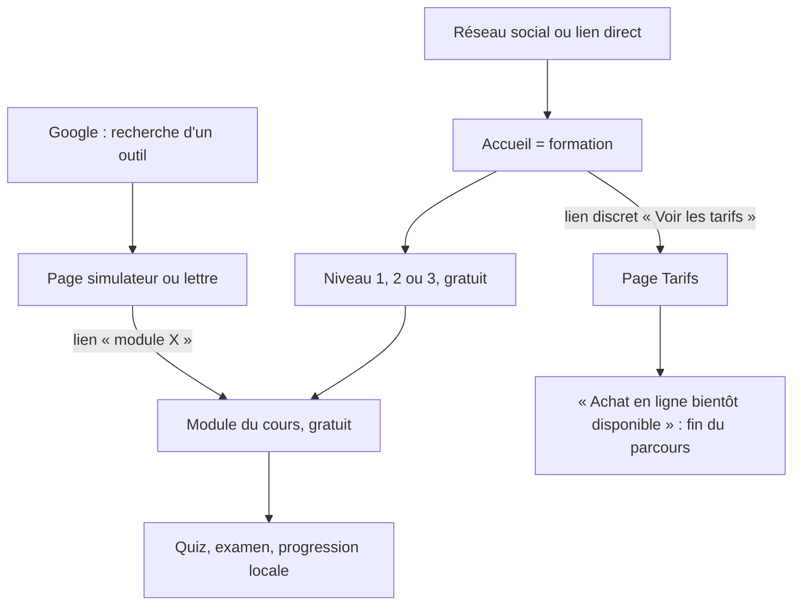
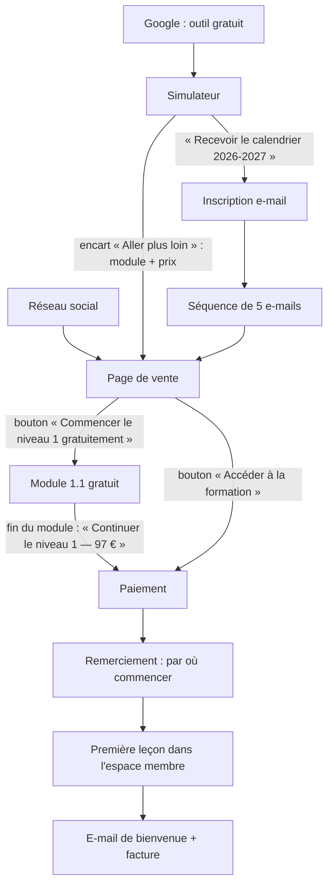

# Audit de conversion — formation-locatif.com

Site audité : version 008 (24 septembre 2026), édition par défaut (la formation en page d'accueil et
les outils gratuits sur `/outils/`). Audit en lecture seule : aucune ligne du site n'a été modifiée.
Captures : `audit/captures/`. Textes prêts à intégrer : `audit/textes-proposes.md`. Maquette de page
de vente : branche `audit/propositions` (non fusionnée).

**Contexte de l'offre (section 1 du prompt).** Seul l'objectif est renseigné : 3 % de conversion.
Complété d'après nos échanges : nom « L'immobilier locatif en France », marque « Formation Locatif »,
domaine formation-locatif.com, prix 97 € (niveau 1), 197 € (niveau 2), 297 € (niveau 3), 447 € les
trois, paiement « pas encore choisi ». Tout le reste est **[À FOURNIR]** : contenu inclus (durée
d'accès, mises à jour, support), garantie, cible prioritaire, canaux d'acquisition, statut et TVA,
preuves, commande locale (c'est `cd site && npm install && npm run dev`, voir `site/README.md`).

Notations : **Constat** = observé et prouvé ; **Hypothèse** = probable, à vérifier ; **Reco** =
recommandation.

---

## 1. Synthèse (dix lignes)

1. **Note : 22 / 100** (grille au § 11). Le produit est solide et rapide ; le site n'est pas encore
   une machine de vente.
2. **Blocage n° 1 : rien n'est à vendre.** Aucun bouton d'achat, aucun paiement, et tout le cours
   (38 modules, quiz, examens) est lisible gratuitement sans compte (§ 2).
3. **Blocage n° 2 : aucun appel à l'action.** L'accueil n'a aucun bouton ; test des 5 secondes :
   4 / 12 en mobile, 5 / 12 en bureau (seuil : 10) (§ 3).
4. **Blocage n° 3 : aucune preuve ni réassurance.** Pas d'auteur, pas d'avis, pas de garantie, pas de
   FAQ, pas de contact, pas de mentions légales (§ 5, § 9).
5. Point fort : 24 outils gratuits bien référencés, qui peuvent devenir la principale source de
   prospects.
6. Point fort : performance et accessibilité excellentes (Lighthouse mobile 99–100, axe sans erreur).
7. **Gain rapide 1** : un bouton « Découvrir le programme » et « Commencer gratuitement le niveau 1 »
   en haut de l'accueil (< ½ jour).
8. **Gain rapide 2** : retirer les jauges « 0 % — 0 module lu » de l'accueil pour un nouveau visiteur
   et y mettre prix et contenu inclus (< ½ jour).
9. **Gain rapide 3** : sur chaque simulateur, un encart « Aller plus loin » vers le module payant qui
   l'explique, avec le prix (< 1 jour).
10. Trois décisions attendues de vous : plateforme de vente, périmètre gratuit / payant, garantie
    (§ 14).

---

## 2. Parcours d'achat

### Parcours actuel (constat)

- **Constat** : le seul chemin vers une offre payante est un lien texte « Voir les tarifs » sous les
  cartes de niveau (`site/src/cours/formation.astro:133`) et un lien de pied de page. La page Tarifs
  n'a aucun bouton d'achat (`site/src/components/Tarifs.astro:48`, `lienAchat` absent de `OFFRES`,
  `site/src/lib/seo.ts:24-28`).
- **Constat — contenu payant non protégé (blocage n° 1)** : site statique ouvert ; les 38 modules, les
  quiz, les 3 examens, les checklists, les annexes et le glossaire sont des pages publiques indexées
  (100 adresses dans `sitemap.xml`). Aucune authentification, aucun paiement. Le PDF n'est pas
  fourni.

### Trois architectures possibles

| Option | Coût | Délai | Expérience élève | Dépendance |
|---|---|---|---|---|
| **1. Plateforme clé en main** (Systeme.io, Podia, Teachable, Schoolmaker) : import des modules, paiement, espace membre, factures, e-mails | 0 à 100 €/mois selon l'offre [tarifs à vérifier] + commission éventuelle | 1 à 2 semaines | Bonne, homogène ; moins de contrôle sur le design | Forte (contenu hébergé chez le prestataire) |
| **2. Site actuel + Stripe + authentification** (Stripe Checkout, Clerk / Supabase Auth / Auth.js, rendu serveur des modules) | Faible en abonnement, élevé en développement | 3 à 6 semaines | La meilleure : le cours actuel (quiz, progression, outils) reste tel quel | Faible ; maintenance technique à votre charge |
| **3. Vitrine + contenu sur plateforme** : le site actuel reste public (outils, programme, extraits) ; le cours complet est chargé sur une plateforme | Abonnement plateforme | 1 à 2 semaines | Deux sites à comprendre ; perte des quiz et de la progression interactive sauf réimport | Moyenne |

**Reco** : l'option 3 pour vendre vite (l'édition « outils » existe déjà : `EDITION=outils`), puis
l'option 2 si les ventes le justifient.

### Périmètre gratuit / payant proposé

| Gratuit (aimant à prospects) | Payant |
|---|---|
| Les 24 outils et les 10 modèles de lettres | Niveaux 1, 2 et 3 complets |
| Mode d'emploi, programme détaillé (titres et objectifs de chaque module) | Quiz, examens et corrigés |
| **Module 1.1 en entier** (extrait gratuit) et la checklist « Mettre en location son premier logement » | Checklists G1 à G6, annexes A, B, D, E, G, H, I |
| Page « À surveiller » (preuve de fraîcheur) | Glossaire complet [à discuter : gratuit, il sert le référencement] |

### Parcours idéal

---

## 3. Test des 5 secondes

Sur les seules captures du haut de page (`audit/captures/*-haut.jpg`). 0 = absent, 1 = flou, 2 = clair.

| Question | Accueil mobile | Accueil bureau | Tarifs mobile | Tarifs bureau |
|---|---|---|---|---|
| Qu'est-ce que c'est ? | 1 — « L'immobilier locatif en France » ressemble à un titre de dossier ; « Formation complète » est en petit | 1 | 1 — « Tarifs de la formation », sans dire laquelle | 1 |
| Pour qui ? | 1 — « Débutant complet » n'apparaît qu'en bas de l'écran, dans la carte N1 | 1 — public des 3 niveaux visible | 1 | 1 |
| Quel résultat concret ? | 1 — « devenir autonome : comprendre, acheter… » : liste de verbes, pas de résultat | 1 | 0 | 0 |
| Pourquoi y croire ? | 1 — date de mise à jour et 38 modules ; aucun auteur ni preuve | 1 | 0 | 0 |
| Combien et quoi exactement ? | 0 — aucun prix visible | 1 — prix dans les cartes ; durée d'accès et contenu inclus inconnus | 1 — 97 € visible, pas le reste | 2 |
| Que faire maintenant ? | 0 — aucun bouton | 0 — seulement un lien texte « Voir les tarifs », sous la ligne de flottaison | 0 — « Achat en ligne bientôt disponible » | 0 |
| **Total** | **4 / 12** | **5 / 12** | **3 / 12** | **4 / 12** |

**Corrections** (textes complets dans `audit/textes-proposes.md`) :
- Q1 et Q3 : titre orienté résultat, par exemple « Louez, gérez et déclarez votre bien sans erreur
  coûteuse », avec en surtitre « Formation en ligne — immobilier locatif ».
- Q2 : une ligne « Pour les futurs et nouveaux bailleurs, et les investisseurs qui veulent optimiser ».
- Q4 : « Contenu à jour au 24 septembre 2026 · textes de loi cités · 24 simulateurs » et l'auteur
  [À FOURNIR].
- Q5 : « Dès 97 € le niveau · 447 € la formation complète » sous le titre.
- Q6 : deux boutons visibles sans défiler : principal « Commencer gratuitement le niveau 1 »,
  secondaire « Voir le programme et les prix ».
- **Maquette** (branche `audit/propositions`, page `/formation-investissement-locatif/`, captures
  `audit/captures/maquette-page-de-vente-*`) : en mobile, Q1 2, Q2 1, Q3 2, Q4 1, Q5 2, Q6 2, soit
  **10 / 12**. Restent à renforcer : « pour qui » au-dessus de la ligne de flottaison et la preuve
  (auteur, avis) [À FOURNIR].
- Retirer du haut de page, pour un nouveau visiteur, la barre « Ma progression : 0 % » et les jauges
  « 0 % — 0 module lu » des cartes (`formation.astro:110-114`) : bruit, et signal « rien n'est
  commencé ».

---

## 4. Personas

| Persona | Intention et 3 premières questions | Réponses du site | Frictions et objections non traitées | Moment de départ | Achat | Ce qui le ferait acheter |
|---|---|---|---|---|---|---|
| **1. Débutante, 28 ans, 1er studio, peur de se tromper** | « Par où commencer ? », « Combien je peux emprunter ? », « Quelles erreurs éviter ? » | Oui : niveau 1, outils capacité d'emprunt et rentabilité, module 1.12 | Aucun parcours « premier achat » ; aucune promesse rassurante ; tout est gratuit, pourquoi payer ? | Après avoir lu 2 modules gratuits : elle a ce qu'il lui faut | Faible (tout est gratuit) | Extrait gratuit puis paiement du niveau 1 ; checklist « premier achat » ; garantie |
| **2. Bailleur, 52 ans, logement F et locataire en retard** | « Puis-je encore louer mon F ? », « Comment récupérer mes loyers ? », « Quelle lettre envoyer ? » | Oui : outil DPE, module 2.13 impayés, lettres F3 et F4 | Aucun lien de l'outil DPE vers « que faire » (travaux, aides) ; pas de contact en cas d'urgence | Après avoir obtenu sa lettre de relance gratuite | Faible à moyenne | Encart sur l'outil DPE et la lettre : « Le plan complet impayés + rénovation : niveau 2 (197 €) » |
| **3. Investisseur LMNP, 40 ans** | « Micro-BIC ou réel ? », « Que coûte la réintégration des amortissements ? », « Et à la revente ? » | Oui : simulateurs micro-BIC / réel et plus-value (réintégration incluse), modules 2.7, 3.5 | Le cas « 11 800 € de plus » (examen final) n'est visible que dans le cours ; rien ne le met en avant | Après le simulateur | Moyenne | Mettre ce cas en avant sur la page de vente ; offre niveau 3 |
| **4. Parent, 60 ans, transmission** | « Donation ou succession ? », « Démembrement ? », « Combien de droits ? » | Oui : simulateur donation, module 3.7 | Page longue et dense sur mobile ; pas de conseil personnalisé (normal, mais à dire clairement) | Au milieu du module 3.7 | Faible à moyenne | Niveau 3 seul (297 €), FAQ « est-ce un conseil personnalisé ? » |
| **5. Sceptique « tout est gratuit »** | « Qu'y a-t-il de plus que service-public et l'ANIL ? », « Qui l'a écrit ? », « Est-ce à jour ? » | Partiel : date de mise à jour visible ; annexe H cite les sources officielles | Aucun argument contre le gratuit ; aucun auteur ; aucun aperçu comparatif | Tout de suite | Faible | Bloc « Pourquoi payer ce qui est gratuit ailleurs » : parcours structuré, cas chiffrés, outils, mise à jour, gain de temps |
| **6. Visiteur pressé, mobile, depuis un réseau social** | « C'est quoi ? », « Combien ? », « C'est pour moi ? » | Non au-dessus de la ligne de flottaison | Titre abstrait, pas de prix, pas de bouton, bandeau « Ma progression » | Dans les 5 secondes | Très faible | Page d'atterrissage dédiée : promesse, prix, bouton, extrait gratuit |

---

## 5. Clarté et force de l'offre

| Critère | État | Preuve | Reco |
|---|---|---|---|
| Promesse principale | **Faible** | « Trois niveaux progressifs pour devenir autonome… » (`formation.astro:70`) : liste de verbes | Promesse de résultat sans gain : « Louez et gérez votre bien sans erreur coûteuse » |
| Mécanisme | **Faible** | Chiffres présents (38 modules, 122 questions, 24 simulateurs) mais jamais expliqués comme méthode | Bloc « Comment ça marche » : 3 niveaux, quiz de validation, outils, lettres, checklists, mise à jour |
| Différenciation face au gratuit | **Absent** | Aucun texte | Bloc dédié (texte proposé) |
| Différenciation face aux concurrents | **Absent** | Comparaison (sources secondaires, non vérifiées) : « Je réussis mon premier investissement locatif » 999 €, modules à 299 € ([investissement-locatif.com](https://www.investissement-locatif.com/formations-investissement-immobilier.html)) ; Rémi Roche Formations 4,8 / 5 sur 185 avis Trustpilot ; une offre « 30 h de vidéo, 14 modules, 91 outils, accès à vie » ([webmarketeurs.fr](https://webmarketeurs.fr/formations-immobilier), [lesmakers.fr](https://lesmakers.fr/formation-immobilier/)) ; garanties de 30 jours chez des acteurs LMNP comme Indy ([declarer-lmnp.com](https://www.declarer-lmnp.com/meilleur-comptable-lmnp-en-ligne-le-comparatif-2026)) ; guides LMNP gratuits ([jedeclaremonmeuble.com](https://www.jedeclaremonmeuble.com/formation-du-loueur-en-meuble/)) | Vos atouts : prix bas (97 € d'entrée), 24 outils, texte à jour au 24 septembre 2026. Points faibles : pas de vidéo, pas d'auteur visible, pas d'avis, pas de garantie |
| Visibilité du produit | **Présent mais non mis en scène** | Tout est visible (c'est même le problème) | Page de vente avec programme repliable et aperçus |
| Structure de l'offre et prix | **Faible** | Prix affichés, aucun achat ; contenu inclus, durée d'accès, mises à jour non précisés ; mention TTC absente | 3 structures à tester (§ 7 des textes) ; préciser accès, mises à jour, facture |
| Réduction du risque | **Absent** | Pas de garantie, pas de FAQ, pas de contact, pas de facture annoncée | Garantie [À FOURNIR], FAQ de 15 objections, contact |
| Fraîcheur comme argument | **Présent, sous-exploité** | Date dans le bandeau de chaque page ; page « À surveiller » (10 encadrés) | En faire un argument de vente : « mise à jour à chaque réforme, date affichée » + politique [À FOURNIR] |
| Preuves | **Absent** | Aucun auteur, aucun avis, aucune méthode décrite ; les sources officielles sont citées dans les modules | Page auteur [À FOURNIR], avis réels après les premières ventes, avec mode de vérification |
| Cohérence promesse / produit | **Faible** | Accueil « 24 simulateurs » alors que les pages de vente futures parlent de 14 (annexe E) ; « Les valeurs proposées reprennent un exemple de la formation » est faux pour 6 outils (DPE, Denormandie, Loc'Avantages, encadrement, usure, TVA) | Aligner les chiffres ; corriger la phrase des 6 outils |

---

## 6. Page de vente, section par section

**Constat : il n'existe pas de page de vente.** La page Tarifs (`site/src/pages/tarifs.astro`) n'a
que les 4 cartes de prix et l'avertissement ; l'accueil est un sommaire du cours.

| Bloc de référence | État | Reco (contenu, emplacement, visuel) |
|---|---|---|
| 1. Haut de page | Absent | Promesse, sous-titre, prix d'appel, 2 boutons, capture réelle d'un simulateur et d'un module |
| 2. Le problème | Absent | Coût des erreurs, illustré par les exemples de la formation : « environ 2 000 € par an » d'écart micro-foncier / réel (module 2.6) et « environ 11 800 € de plus » à la revente LMNP (examen final), présentés comme exemples, jamais comme gains garantis |
| 3. Solution et mécanisme | Absent | 3 niveaux, quiz, 24 outils, 10 lettres, checklists, mise à jour |
| 4. Programme détaillé | Présent ailleurs | Les pages de niveau listent les modules ; à reprendre en sections repliables sur la page de vente |
| 5. Démonstration | Partiel | Tout est accessible ; il faut désigner l'extrait (module 1.1) et un simulateur de démonstration |
| 6. Pour qui / pour qui ce n'est pas | Partiel | « Public » des niveaux ; ajouter « pas pour vous si vous cherchez un conseil personnalisé ou une méthode d'enrichissement rapide » |
| 7. Auteur et méthode | Absent | [À FOURNIR] parcours de l'auteur ; méthode : sources officielles, date de mise à jour |
| 8. Preuves | Absent | [À FOURNIR] avis réels ; en attendant : extraits gratuits et exemples chiffrés du cours |
| 9. L'offre | Partiel | Cartes de prix existantes ; ajouter contenu inclus, accès, mises à jour, facture, TTC ou mention TVA |
| 10. Garantie | Absent | [À FOURNIR] ; option : 14 jours satisfait ou remboursé (à arbitrer avec le droit de rétractation, § 9) |
| 11. FAQ (≥ 15 objections) | Absent | Textes dans `audit/textes-proposes.md` |
| 12. Bouton final | Absent | Rappel du risque réduit + bouton |

**Audit des boutons d'appel à l'action**

| Critère | Constat |
|---|---|
| Nombre | 0 bouton d'achat sur tout le site ; 1 lien texte « Voir les tarifs » sur l'accueil |
| Libellés | Aucun verbe + bénéfice (« Achat en ligne bientôt disponible » est un texte, pas un bouton) |
| Contraste et position | Lien bleu dans un paragraphe, sous la ligne de flottaison en mobile et en bureau |
| Répétition | Aucune |
| Destination | Cohérente (Tarifs) mais sans suite |
| Taille tactile mobile | Les liens respectent la taille minimale (axe WCAG 2.2 « target-size » sans erreur) |

---

## 7. Textes proposés

Voir `audit/textes-proposes.md` : 5 titres, 3 sous-titres, 5 libellés de bouton, réécriture des
3 sections les plus faibles (haut de page, bloc « pourquoi payer ? », offre), 16 questions de FAQ,
3 structures d'offre à tester et une séquence de 5 e-mails. Tous conservent l'avertissement et
n'inventent aucun chiffre ; les données manquantes sont marquées [À FOURNIR].

**Jargon au-dessus de la ligne de flottaison** : l'accueil n'en a pas ; les pages d'outils utilisent
DPE, IRL, LMNP, micro-BIC dès le titre. C'est voulu pour le référencement (ce sont les mots
recherchés), mais le sous-titre doit les expliquer (« LMNP : location meublée non professionnelle »).

---

## 8. Paiement, capture de prospects et après-achat

**Paiement : inexistant.** Aucun des points à vérifier (étapes, moyens de paiement, paiement en
plusieurs fois, prix TTC, erreurs, remerciement, facture, accès immédiat, relance de panier) ne peut
être testé.

**Capture de prospects : inexistante.** Aucun formulaire, aucun e-mail.

- **Reco** : aimant principal = « Calendrier des échéances du bailleur 2026-2027 » (issu de
  l'annexe B et de la page « À surveiller » : fin de l'encadrement au 24 novembre 2026, DPE 1,7 au
  1er janvier 2027, F non décent au 1er janvier 2028…), proposé sur chaque simulateur. Double
  consentement, mention RGPD, désinscription en un clic.
- Séquence de 5 e-mails : voir `audit/textes-proposes.md`.

**Après-achat (ce qui existe déjà et servira)** : progression par module, quiz avec seuil de 70 %,
meilleur score mémorisé, examens, statut « quiz réussi ». Manquent : e-mail de bienvenue, « par où
commencer » (le mode d'emploi existe, `/mode-d-emploi/`), demande d'avis après l'examen du niveau,
annonce des mises à jour. La progression est stockée dans le navigateur : elle ne suit pas l'élève
d'un appareil à l'autre (limite du site statique).

---

## 9. Confiance et conformité (France)

| Exigence | Présente ? | Risque | Correction proposée |
|---|---|---|---|
| Mentions légales (éditeur, directeur de publication, hébergeur) | **Non** | Sanction pénale (LCEN, art. 6) ; perte de confiance | Page `/mentions-legales/` [identité À FOURNIR] ; hébergeur Vercel |
| CGV (prix TTC, paiement, accès, durée, mises à jour, remboursement) | **Non** | Vente impossible légalement | Rédiger avec la plateforme choisie |
| Rétractation 14 jours ; contenu numérique immédiat : accord exprès + renoncement exprès + confirmation écrite (art. L. 221-28 C. consom.) | **Non** | Remboursement exigible jusqu'à 14 jours après l'achat | Deux cases à cocher au paiement + e-mail de confirmation |
| Médiateur de la consommation | **Non** | Amende administrative | Adhérer à un médiateur et le citer dans les CGV |
| Politique de confidentialité et cookies (CNIL) | **Partiel** : section « Confidentialité » dans À propos ; aucun cookie, aucun traceur (`_headers`, code) | Faible aujourd'hui ; à revoir dès qu'un outil de mesure ou un formulaire e-mail est ajouté | Page dédiée ; bandeau seulement si traceur non exempté |
| Mention TVA | **Non** | Prix affichés ambigus | « Prix TTC » ou « TVA non applicable, art. 293 B du CGI » selon votre régime [À FOURNIR] |
| Avis clients (existence et vérification) | Sans objet (aucun avis) | — | Afficher le mode de vérification dès les premiers avis |
| Pratiques trompeuses (fausse urgence, faux prix barré, promesse de gain) | **Conforme** | « 447 € au lieu de 591 € » est un vrai calcul (97 + 197 + 297) et non un prix barré fictif | Garder cette formulation factuelle |
| Qualifications (certifiante, Qualiopi, CPF) | **Conforme** (aucune mention) | — | Ne pas en ajouter sans certification réelle |
| Avertissement « ne remplace pas un conseil personnalisé » | **Présent, discret** (`Avertissement.astro:9`, texte à 0,78 rem, `global.css:999`) | Visible mais peu remarqué ; la règle 3 du prompt demande qu'il reste visible | Le garder ; ajouter une mention courte dans la FAQ et près des résultats qui concluent (DPE, encadrement) |
| Accessibilité | **Bon** (axe WCAG 2.2 AA sans erreur, clavier testé) | Obligation selon la taille de l'entreprise (directive européenne, juin 2025) | Tests manuels : `TESTS-MANUELS.md` ; déclaration d'accessibilité |
| Contact | **Non** | Confiance, obligation d'information précontractuelle | Adresse e-mail ou formulaire |

Ce tableau ne remplace pas l'avis d'un juriste. Points à lui soumettre : CGV et parcours de
renoncement à la rétractation, choix du médiateur, garantie « satisfait ou remboursé » face au
renoncement, responsabilité liée aux outils qui concluent (« logement non décent », « loyer non
conforme ») et aux modèles de lettres (congé, mise en demeure), mention TVA.

---

## 10. Performance, référencement et mesure

**Performance (Lighthouse mobile, 24 septembre 2026, serveur compressé)** : voir le tableau en
annexe de ce fichier. Accueil et Tarifs : performance 99, accessibilité, bonnes pratiques et
référencement 100, LCP 1,8 s, CLS 0, TBT 0 ms, 130 Ko par page. Polices hébergées et préchargées,
pas d'image lourde, aucun script tiers.

**Référencement** :
- Accueil : titre « L'immobilier locatif en France | Formation Locatif », sans les mots recherchés
  (« formation investissement locatif », « formation LMNP »). **Reco** : « Formation investissement
  locatif en ligne : louer, gérer, déclarer | Formation Locatif ».
- Pas de page de vente, donc aucune page ne vise « formation investissement locatif », « formation
  LMNP », « devenir propriétaire bailleur », « formation gestion locative ».
- Données structurées : `Course` sur l'accueil (avec offres et `hasCourseInstance`) ; `Course` sur
  Tarifs sans `hasCourseInstance` ; pas de `FAQPage` (pas de FAQ ; Google n'affiche plus ces extraits
  que pour quelques sites) ; `Product` inutile en plus de `Course`.
- 59 titres sur 100 dépassent 70 caractères.

**Mesure : aucun outil.** Plan de marquage proposé, avec une solution sans cookie (Vercel Web
Analytics, Plausible ou Umami), à activer seulement avec le consentement si l'outil choisi dépose un
traceur :

| Événement | Déclencheur | Page |
|---|---|---|
| `vue_page_vente` | Affichage | Page de vente |
| `clic_cta_principal` | Clic sur le bouton principal | Toutes |
| `debut_contenu_gratuit` | Ouverture du module 1.1 depuis un bouton | Module 1.1 |
| `inscription_email` | Confirmation du double consentement | Formulaire |
| `debut_paiement` | Clic vers la plateforme de paiement | Tarifs, vente |
| `achat` | Retour de la plateforme (webhook ou page de remerciement) | Remerciement |
| `premiere_lecon` | Première ouverture d'un module payant | Espace membre |

Tableau de bord minimal : visiteurs, entonnoir des 7 événements, sources, taux de conversion
visiteur → acheteur. Avec peu de trafic au départ, préférer des tests séquentiels (une modification,
deux à quatre semaines, comparaison avant / après) aux tests A/B.

---

## 11. Grille de notation

| Axe | Note / 5 | Justification | Poids | Points |
|---|---|---|---|---|
| Compréhension immédiate | 1 | Test des 5 secondes à 4 / 12 (mobile) et 5 / 12 (bureau) | 20 | 4 |
| Clarté et force de l'offre | 1 | Prix affichés mais contenu inclus, garantie et différenciation absents | 20 | 4 |
| Page de vente | 0 | Inexistante | 15 | 0 |
| Paiement et après-achat | 1 | Pas de paiement ; bonne base d'après-achat (progression, quiz, examens) | 15 | 3 |
| Preuves et confiance | 1 | Date de mise à jour et sources officielles ; pas d'auteur, d'avis, de contact | 10 | 2 |
| Conformité | 2 | Pas de mentions légales ni CGV ; pas de pratique trompeuse ; RGPD sain ; accessibilité bonne | 10 | 4 |
| Performance et mobile | 5 | Lighthouse 99–100, CLS 0, mobile vérifié à 320 px | 5 | 5 |
| Mesure | 0 | Aucun outil | 5 | 0 |
| **Total** | | | **100** | **22** |

Calcul : points = note ÷ 5 × poids. **Note finale : 22 / 100.**

---

## 12. Plan d'action priorisé (méthode ICE, notes de 1 à 10)

### Gains rapides (moins d'une journée)

| # | Problème | Preuve | Reco | Fichiers | Effort | I / C / E | Indicateur |
|---|---|---|---|---|---|---|---|
| A1 | Pas de bouton en haut d'accueil | Captures accueil ; § 3 | 2 boutons : « Commencer gratuitement le niveau 1 » → module 1.1, « Voir le programme et les prix » → Tarifs | `src/cours/formation.astro` | 2 h | 9 / 8 / 9 | `clic_cta_principal` / visiteurs |
| A2 | Titre sans résultat | `formation.astro:69-70` | Surtitre + titre + sous-titre proposés | idem | 1 h | 8 / 6 / 10 | Test des 5 s ≥ 10 / 12 |
| A3 | Jauges « 0 % » pour un nouveau visiteur | `formation.astro:110-114` | Les masquer tant qu'aucun module n'est lu | idem, `scripts/global.ts` | 2 h | 5 / 7 / 8 | — |
| A4 | Aucun lien outil → offre | Pages simulateurs | Encart « Aller plus loin » : module qui explique + prix du niveau | `src/pages/simulateurs/[id].astro` | 3 h | 8 / 7 / 8 | Clics encart / vues outil |
| A5 | Phrase fausse sur 6 outils | § 5 | « Les valeurs proposées sont un exemple » | `src/pages/simulateurs/[id].astro`, `simulateurs.ts` | 1 h | 3 / 10 / 10 | — |
| A6 | Titre de page de l'accueil sans mots recherchés | § 10 | Nouveau titre | `src/cours/formation.astro` | 15 min | 6 / 6 / 10 | Positions Search Console |

### Chantiers d'une à deux semaines

| # | Problème | Reco | Effort | I / C / E | Indicateur |
|---|---|---|---|---|---|
| B1 | Rien à vendre, contenu ouvert | Choisir la plateforme ; option 3 (vitrine + plateforme) ; publier `EDITION=outils` + extraits | 1–2 sem. | 10 / 9 / 5 | Ventes |
| B2 | Pas de page de vente | Page `/formation-investissement-locatif/` (maquette sur `audit/propositions`) | 3 j | 9 / 8 / 6 | Conversion de la page |
| B3 | Pas de conformité de vente | Mentions légales, CGV, rétractation, médiateur, TVA | 2–3 j + juriste | 9 / 9 / 5 | — |
| B4 | Pas de capture d'e-mails | Aimant « calendrier 2026-2027 » + séquence de 5 e-mails | 3 j | 8 / 7 / 6 | `inscription_email` / visiteurs outils |
| B5 | Pas de mesure | Outil sans cookie + plan de marquage | 1 j | 7 / 9 / 8 | Entonnoir disponible |
| B6 | Pas de FAQ ni de garantie | FAQ de 16 questions ; garantie [À FOURNIR] | 1 j | 7 / 7 / 8 | Conversion page de vente |

### Chantiers structurels

| # | Reco | Indicateur |
|---|---|---|
| C1 | Espace membre intégré (option 2) si les ventes le justifient : progression synchronisée, accès sécurisé | Rétention, premières leçons |
| C2 | Preuves : page auteur, collecte d'avis vérifiés après l'examen de chaque niveau | Nombre d'avis, conversion |
| C3 | Pages d'atterrissage par canal (réseaux sociaux, requêtes « formation LMNP »…) | Conversion par source |
| C4 | Titres des modules raccourcis ; contenus d'accompagnement des outils | Trafic organique |

---

## 13. Plan de tests

| # | Hypothèse | Variante | Indicateur | Arrêt |
|---|---|---|---|---|
| T1 | **Si** l'accueil affiche un bouton « Commencer gratuitement le niveau 1 », **alors** plus de visiteurs démarrent le cours, **parce que** l'action suivante devient évidente | Bouton vs lien texte | `debut_contenu_gratuit` / visiteurs | 4 semaines ou 1 000 visiteurs |
| T2 | **Si** chaque simulateur propose le module payant qui l'explique avec son prix, **alors** le trafic des outils se transforme en visites de la page de vente, **parce que** l'intention est déjà là | Encart vs absence | Clics encart / vues outil | 4 semaines |
| T3 | **Si** l'offre met en avant le pack à 447 € plutôt que les niveaux séparés, **alors** le panier moyen augmente, **parce que** l'économie de 144 € est explicite | Pack en premier vs niveau 1 en premier | Panier moyen, conversion | 50 ventes |
| T4 | **Si** l'aimant « calendrier 2026-2027 » remplace un aimant générique, **alors** l'inscription augmente, **parce que** les échéances sont concrètes et datées | Calendrier vs checklist | `inscription_email` / visiteurs | 4 semaines |
| T5 | **Si** le problème est illustré par les exemples chiffrés du cours (≈ 2 000 €/an, ≈ 11 800 €), **alors** la conversion de la page de vente augmente, **parce que** le coût d'une erreur devient tangible | Avec / sans le bloc « problème » | Conversion page de vente | 4 semaines |

---

## 14. Questions ouvertes pour le propriétaire

1. **Plateforme de vente** : option 1, 2 ou 3 (§ 2) ? Laquelle ?
2. **Gratuit / payant** : validez-vous le périmètre proposé (outils, lettres, module 1.1, checklist
   de mise en location gratuits) ?
3. **Garantie** : aucune, 14 jours, 30 jours ? Conditions ?
4. Contenu inclus : durée d'accès (à vie, 1 an ?), mises à jour incluses (jusqu'à quand ?), support
   (e-mail ?), PDF ?
5. Statut du vendeur et régime de TVA ; identité pour les mentions légales ; adresse de contact.
6. Auteur : nom, parcours, photo, pourquoi il est légitime [À FOURNIR, ne rien inventer].
7. Canaux d'acquisition prioritaires ?
8. Paiement en plusieurs fois souhaité ?
9. Outil de mesure : accord pour une mesure sans cookie ?
10. Objectif chiffré de ventes par mois (en plus des 3 % de conversion) ?

---

## Annexe — Lighthouse mobile des pages clés

Mesure du 24 septembre 2026, profil mobile, serveur de test compressé (`audit/lighthouse-pages-cles.json`).

| Page | Performance | Accessibilité | Bonnes pratiques | Référencement | LCP | CLS | TBT | Poids |
|---|---|---|---|---|---|---|---|---|
| `/` | 99 | 100 | 100 | 100 | 1.8 s | 0 | 0 ms | 130 Ko |
| `/tarifs/` | 99 | 100 | 100 | 100 | 1.8 s | 0 | 0 ms | 130 Ko |
| `/niveau-1/` | 100 | 100 | 100 | 100 | 1.8 s | 0 | 0 ms | 131 Ko |
| `/module/1-1/` | 100 | 100 | 100 | 100 | 1.8 s | 0 | 0 ms | 139 Ko |
| `/outils/` | 100 | 100 | 100 | 100 | 1.7 s | 0 | 0 ms | 132 Ko |
| `/simulateurs/rentabilite/` | 99 | 100 | 100 | 100 | 2.0 s | 0 | 0 ms | 160 Ko |
| `/lettres/revision-du-loyer/` | 100 | 100 | 100 | 100 | 1.8 s | 0 | 0 ms | 134 Ko |
| `/mode-d-emploi/` | 100 | 100 | 100 | 100 | 1.8 s | 0 | 0 ms | 133 Ko |
